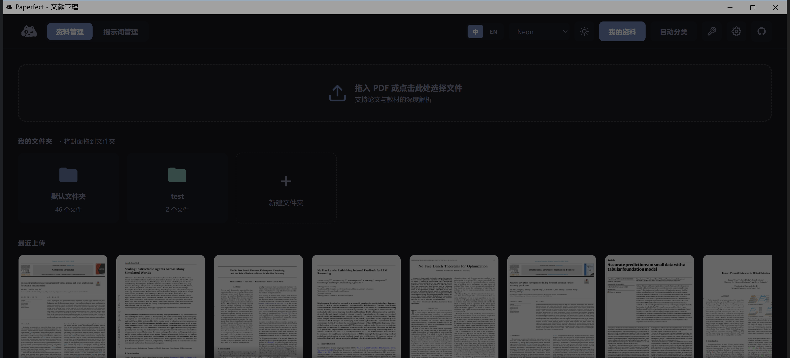
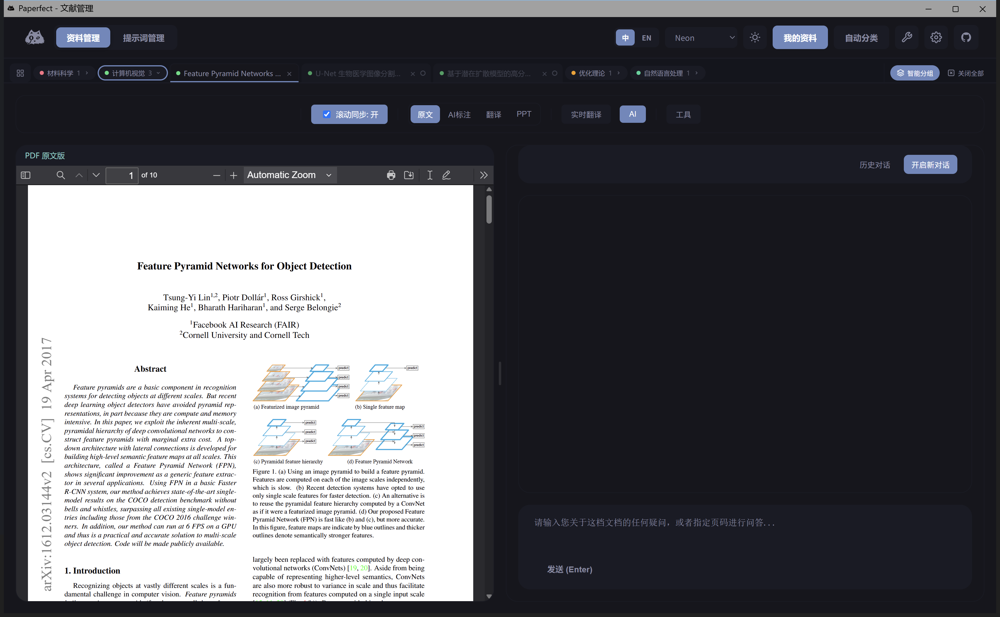

<div align="center">


# Paperfect

**把论文读懂，把证据讲清楚。**

本地文献工作台 · 中文图文翻译 · 深度解读 · 可编辑学术 PPT · MCP / Skills

[快速开始](#快速开始) · [功能](#能做什么) · [AI 扩展](docs/extensions.md) · [架构](docs/architecture.md) · [贡献](CONTRIBUTING.md)

</div>

Paperfect 将论文导入、阅读、翻译、语义批注、问答和汇报准备放在同一个工作区。PDF 与处理产物保存在本机；AI 功能使用你配置的模型服务。服务地址、模型 ID 和 API Key 均可修改，也可按任务分别选择。

适合需要阅读英文论文、准备组会报告，以及希望将论文处理接入自己 AI 工作流的研究者。



## 能做什么

| 场景 | 功能与产物 |
| --- | --- |
| 整理文献 | PDF 导入、元数据、标签、分类、库内搜索和相关文献 |
| 对照阅读 | 多标签阅读器、原文/译文/批注/PPT 分栏、AI 伴读 |
| 中文图文翻译 | 传统版式 PDF 翻译；新增重排 HTML 阅读版、可编辑表格、图注和图内标签中文化 |
| 复用配图 | 导出原始 SVG；生成原图底图＋中文文字层的 SVG；PPT 中中文标签为独立文本框 |
| 理解文章 | 详细说明动机、输入输出、方法机制、实验条件、结果与局限；附物理页码和引文定位 |
| 准备汇报 | Skills 驱动的正文讲解页＋配图标注＋详细演讲备注；导出 PPTX 与页码映射 |
| 接入其他 AI | 本地 MCP 工具、可复制的 Agent Skills、共享生成规范 |
| PDF 日常处理 | 图片导出、文档转换、OCR、旋转、拆分、合并、压缩等工具 |



截图展示现有桌面工作区；新增的「精读与图译」入口在论文阅读页顶部。

## 从论文到汇报

1. **配置服务**：打开「账户设置」，填 API Base URL、模型 ID 和 Key。可以将解析配置一次应用到所有任务，也可以分开配置。
2. **导入 PDF**：选择解析提示词、生成语言和处理阶段。后台生成知识库、传统译文、批注或 PPT。
3. **精读与图译**：在阅读页选择翻译页码，例如 `1-5,8`；可开启图内标签翻译，生成中文 HTML 与 SVG 素材。详细解读覆盖整篇 PDF 的可提取文字。
4. **检查证据**：对照原文，查看未完成页、图内标签、引文定位和待核查项。机器稿的 `complete` 表示生成完成，不代表人工审稿通过。
5. **制作 PPT**：先生成中文阅读版，再生成或重新生成 PPT，可复用匹配到的中文配图。较长的机制解释保存在演讲备注中。

完整操作说明见 [用户手册](docs/Paperfect用户使用说明书.html)，新增接口见 [扩展文档](docs/extensions.md)。

## 快速开始

主要支持 **Windows 10/11 x64**。源码开发建议 Python 3.11+；PPT 需要 Node.js。当前桌面打包与完整流水线以 Windows 为验证平台。

### 安装包

本次发布为源码预览版，[GitHub Releases](https://github.com/waiteddegree608-ship-it/paperfect/releases) 提供源码。当前未发布包含本次改造的新版安装包，请按下文从源码运行。

安装后在「账户设置」配置服务。你的 API 消费由所选服务商计费，软件不附赠模型额度。

### 从源码运行

```powershell
git clone https://github.com/waiteddegree608-ship-it/paperfect.git
cd paperfect
python -m venv venv
.\venv\Scripts\Activate.ps1
python -m pip install -r requirements.txt
Copy-Item .env.example .env
npm ci --prefix backend/standalone_pdf2ppt/ppt_maker
python backend/main.py --headless
```

浏览器打开 `http://127.0.0.1:8900`。端口若被占用，以启动日志为准。也可运行 `python backend/main.py` 使用原生窗口，或在根目录 `npm ci` 后运行 `npm start` 启动 Electron。

若 PowerShell 阻止激活脚本，可直接使用 `venv\Scripts\python.exe` 执行 Python 命令，无须修改系统执行策略。

### API 配置

使用兼容 **OpenAI Chat Completions** 的 API Base URL，通常以 `/v1` 结尾；不要填写完整 `/chat/completions` 请求地址。模型名称填写服务商实际支持的 ID，Paperfect 不会因为模型名包含 `reasoner` 或 `vision` 就自动换成别的模型。

| 任务 | 配置前缀 | 模型要求 |
| --- | --- | --- |
| 论文解析 | `PARSE_` | 解析路径可能使用页面图像，建议支持视觉 |
| 伴读问答 | `CHAT_` | 文本模型 |
| 元数据与详细解读 | `PAPER_` | 文本模型 |
| 语义批注 | `ANNOTATOR_` | 文本模型 |
| 翻译与图译 | `TRANSLATE_` | 中文图文阅读版需要视觉输入 |
| PPT | `PPT_` | 配图标注需要视觉输入 |

每个前缀支持 `API_URL`、`API_KEY`、`MODEL`。留空的 URL/模型继承解析配置；同一服务地址下可继承解析 Key，不跨不同服务地址隐式复制 Key。多 Key 用逗号分隔；这是多凭据选择机制，不保证消除服务商限流。保存后对新任务生效。

旧版仅配置 Key 的安装仍保留原来的默认服务与模型，便于继续使用。更换服务商时建议在设置页明确填全三个字段。目前没有通用 Responses-only 或 Anthropic 原生协议适配；仅提供这些协议的端点需先接入兼容网关。

## 让 AI 按规范工作

项目内置三份生成 Skill：

- [paper-translation](backend/skills/paper-translation/SKILL.md)：完整翻译、表格重建、公式保留、图内标签与不确定区域处理。
- [paper-reading](backend/skills/paper-reading/SKILL.md)：根据文章类型解释方法和证据，区分作者结论与分析者判断。
- [paper-presentation](backend/skills/paper-presentation/SKILL.md)：组织汇报论证、控制页面信息量、保留详细备注和来源。

这些文件直接参与模型请求，修改后会影响对应生成流程。外部 Agent 可通过 MCP 的 `list_skills` 和 `read_skill` 读取同一套规范。

```powershell
python -m pip install -r paperfect_agent/requirements.txt
python paperfect_agent/server.py
```

最后一条启动的是 stdio MCP 服务，通常由客户端启动。配置示例、工具列表与安装方法见 [Agent Pack](paperfect_agent/README.md) 和 [扩展文档](docs/extensions.md)。

## 文件与隐私

用户数据位于 `data/`，论文的原件、译文、PPT、缓存位于 `data/papers/<book>/`。外部 MCP 可用 `PAPERFECT_WORK_DIR` 指定独立目录。

“本地优先”指文件与工作区保存在本机。启用 AI 功能时，相关论文文字、页面图像或配图会发给你配置的服务商；元数据补全也可能查询外部公开服务。`.env` 保存本机凭据，应妥善保管。

便携版与安装版构建使用空白 `env.release.template`，不复制开发者 `.env`。源码导出工具排除文献、视频、缓存、安装包、私人配置和 Git 历史。

## 开发与验证

```powershell
python -m unittest discover -s tests -v
node --check backend/standalone_pdf2ppt/ppt_maker/generate_full_ppt.js
python scripts/export_source.py --output ..\paperfect-source
```

测试使用合成 PDF 和本地模拟 API，不消耗真实模型额度。PPT 集成测试需先安装对应 Node 依赖；否则会明确跳过。真实论文的翻译与图表质量仍需对照原文验证，结构测试不能替代视觉审查。

打包：

```powershell
python build_portable_exe.py
python build_installer.py
```

输出分别位于 `dist_portable/` 和 `dist_electron/`。更新后端或新增服务后需完整重建，不能使用仅复用旧后端的快速选项。

## 当前边界

- 中文 SVG 的底图可能是位图；只有标签是可编辑文本，原始 SVG 则保留 PDF 中原本存在的矢量部分。
- 图内文字覆盖可能遮挡线条或挤压文字，需要视觉核查。无法可靠定位时保留原图与失败记录。
- 详细解读使用 PDF 可提取文本，扫描件需 OCR；引文匹配不等于科学结论核验。
- PPT 的源码页摘录会记录截断，图表、公式和复杂版式可能需要手动调整。当前未承诺任意论文都无需修改即可用于正式报告。
- 服务面向本机单用户，未提供公网多用户认证部署。

## 参与与许可

欢迎通过 Issues 提交最小复现、匿名样例或改进建议，也欢迎贡献提示词、适配器和测试。请阅读 [贡献指南](CONTRIBUTING.md)。

Paperfect 自有代码采用 [MIT](LICENSE)。第三方依赖、字体、图标和用户导入的论文保留各自许可；尤其 PyMuPDF、PDF 翻译组件不因此变为 MIT。详情见 [第三方声明](THIRD_PARTY_NOTICES.md)。
